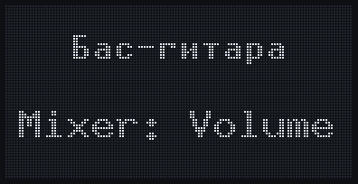
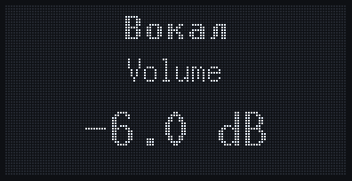
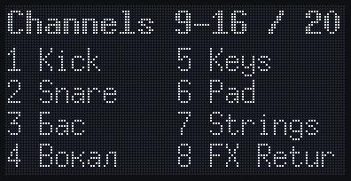

# Novation Launchkey MK4 для Fender Studio Pro

Неофициальная интеграция **Novation Launchkey MK4** (25 / 37 / 49 / 61) с **Fender Studio Pro**
(бывший PreSonus Studio One): транспорт, фейдеры микшера, энкодеры Control Link, пэды
Launcher и экран клавиатуры — в том числе с русскими названиями треков, которых нет во
встроенном шрифте Launchkey.

[English version](README.md)

## Требования

- Fender Studio Pro 8 (проверено: 8.1.2, Windows 11). В Studio One 6 / 7 похожая система
  скриптов, может заработать, но не проверялось.
- Launchkey MK4 25 / 37 / 49 / 61 (проверено на 49). Протокол у всех одинаковый. У 25 и 37 нет
  фейдеров, из транспортных кнопок только Play и Record, а Track ‹ › — это Shift + стрелки пэдов.
- **Launchkey Mini MK4** не поддерживается: у неё другой SysEx-заголовок и другой набор кнопок.
- macOS: имена портов прописаны, но проверялось только на Windows.

## Установка

1. Скачайте `launchkey-mk4-studio-pro-*.zip` в
   [Releases](https://github.com/miraer/launchkey-mk4-studio-pro/releases) и распакуйте.
2. Скопируйте папку `Novation Launchkey MK4` в
   - Windows: `%APPDATA%\Fender\Studio Pro 8\User Devices\`
   - macOS: `~/Library/Application Support/Fender/Studio Pro 8/User Devices/` (не проверялось)

   Если папки `User Devices` нет, создайте её.
3. Перезапустите Studio Pro.
4. **Options → External Devices → Add… → Novation → Launchkey MK4 DAW** и выберите
   DAW-порты Launchkey (второй USB MIDI-интерфейс), например для 49:  
   Receive From: `MIDIIN2 (Launchkey MK4 49 MIDI)`  
   Send To: `MIDIOUT2 (Launchkey MK4 49 MIDI` (Windows обрезает имена портов до 31 символа)
5. Клавиатура на порту `Launchkey MK4 49 MIDI` остаётся обычным устройством: ноты, Drum-пэды,
   pitch bend и модуляция идут через неё. Если на DAW-портах висит устройство HUI или Mackie
   Control, удалите его.

## Управление

| Контрол | Действие | С Shift |
|---|---|---|
| Play / Stop | Старт-пауза / Стоп | Play from Loop Start / Return to Zero |
| Record / Loop | Запись / Цикл | Autopunch / Loop Selection |
| Metronome | Клик | Предотсчёт (precount) |
| Capture MIDI | Recall Retrospective Recording | — |
| Quantise / Undo | Quantize / Undo | Quantize 50% / Redo |
| Track ‹ › | Предыдущий / следующий трек | Банк из 8 каналов влево/вправо |
| Фейдеры 1–8, 9 | Громкость 8 каналов банка, Main | |
| Кнопки фейдеров | Select (цвет трека) или Arm (красный) | |
| Arm/Select | Переключить режим кнопок фейдеров | |

**Энкодеры** (режим выбирается на Launchkey через Shift + пэды):

| Режим | Энкодеры | ▲ / ▼ рядом с энкодерами |
|---|---|---|
| Plugin | Control Link сфокусированного плагина | Страницы Control Link; с Shift — пред./след. плагин в рэке |
| Mixer | Volume или Pan 8 каналов | ▲ Volume, ▼ Pan |
| Sends | Уровень посыла N у 8 каналов | Выбор посыла 1–8 |
| Transport | Такт ±, Zoom H, Zoom V, сдвиг цикла, маркеры, треки, секции аранжировки, темп | ▲ — поставить маркер |

**Пэды** (DAW-режим пэдов):

| Кнопка | Launcher-страница | Mute/Solo-страница |
|---|---|---|
| Пэды | Клипы Launcher (2 дорожки × 8 сцен) | Верхний ряд — Mute, нижний — Solo |
| ▲ / ▼ слева | Дорожки Launcher (с Shift — сцены) | Банк каналов |
| Scene Launch | Нажатие — вид «Сцены» (16 сцен), удержание — временно | — |
| Shift + Scene Launch | Launcher: Stop All | — |
| Function | Переключить Launcher ↔ Mute/Solo | |
| Shift + Function | Показать/скрыть окно Launcher | |

## Какие каналы на фейдерах

Фейдеры 1–8 (и энкодеры в режимах Mixer/Sends, и пэды Mute/Solo) берут каналы из **Remote Bank**
Studio Pro по порядку микшера: Console (F3) → кнопка **Channel List** в левой колонке → кнопка
**Remote** → кружками показать/скрыть каналы, затем снова **Remote**. Скрытые там каналы
фейдеры пропускают, порядок меняется перестановкой каналов в микшере. Shift + Track ‹ ›
листает банк по 8; при выборе трека банк сам перелистывается к нему. Фейдер 9 — Main.

После перелистывания экран показывает, что теперь на фейдерах: «Channels 9-16 / 20» и
пронумерованные названия каналов. Пока Shift зажат, Launchkey показывает свой экран режимов
(например «Transport / Drum»), поэтому список появляется после отпускания Shift.

## Экран

Встроенный шрифт Launchkey знает только латиницу (ASCII). Экраны с кириллицей (названия
треков, каналов, плагинов) скрипт рисует сам и отправляет картинкой 128×64: главный экран,
всплывающие окна фейдеров и энкодеров, уведомления. Список каналов на фейдерах — всегда
картинкой: родной экран на 8 имён обрезает их до ~4 букв. Значение во всплывающем окне
обновляется до ~10 раз в секунду (быстрее Launchkey картинки не принимает). Тексты только
латиницей показываются родным шрифтом. Если клавиатура не подтверждает приём картинок,
скрипт сам возвращается к транслиту.

## Настройка

`LaunchkeyMK4MidiDevice.js`, `kLaunchkeyMK4FaderPickup`:
- `false` (по умолчанию) — фейдер всегда передаёт своё физическое положение;
- `true` — «подхват» прошивки Launchkey: фейдер начинает менять значение только после того,
  как дойдёт до текущего значения в DAW.

После изменения скриптов перезапустите Studio Pro.

## Если что-то не работает

- Ошибки скриптов пишутся в `%APPDATA%\Fender\Studio Pro 8\Studio Pro.log`.
- Устройства нет в списке Add… — проверьте, где лежит папка, и перезапустите Studio Pro.
- Фейдеры и энкодеры ничего не делают — проверьте, что Receive From / Send To — это DAW-порты
  (`MIDIIN2` / `MIDIOUT2`), а не порт клавиатуры.

Сообщения об ошибках и pull request'ы приветствуются; укажите модель Launchkey, систему и
версию Studio Pro.

## Лицензия

[MIT](LICENSE). Шрифты экрана — X.Org misc-fixed (public domain). Протокол — по Programmer's
Reference Guide v3.0 от Novation, проверен на клавиатуре. Novation, Launchkey, Fender, Studio Pro
и Studio One — торговые марки их владельцев; проект с ними не связан.
